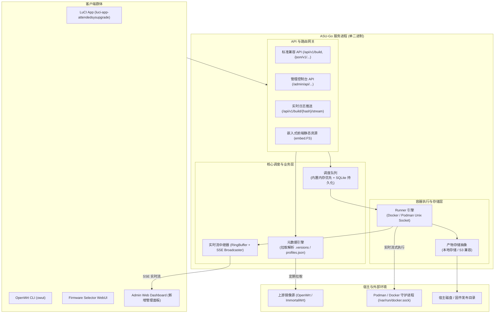

# ASU-Go 整体系统架构设计

本文档阐述 ASU-Go 的架构蓝图。外部参考基准为 OpenWrt 官方 Python ASU 实现（路径参考：`/data/app-stacks/asu`）。

---

## 1. 原版 Python ASU 的架构痛点与对比

原版 ASU 采用的是标准的 Python 异步后端微服务组合：
- **Web 框架**：FastAPI + Uvicorn
- **异步队列**：Redis + RQ Worker
- **统计分析**：Redis Stack（强制依赖 RedisTimeSeries 模块）
- **容器管理**：基于 Podman Python SDK (`podman-py`)，通过 Unix Socket 通信
- **存储后端**：本地文件目录或 S3 (`boto3`)

### 核心痛点剖析
1. **构建过程是完全黑盒（缺乏可观测性）**：
   原版使用 `container.exec_run(...)` 整体阻塞执行 `make image` 命令。在执行期间（通常需要 2 至 10 分钟），标准输出没有被流式捕获，也没有任何增量推送给调用者。客户端与管理员只能干等，遇到网络卡顿或编译死循环无法即时察觉。
2. **缺乏可视化管理与运维中枢**：
   仅提供只读的静态图表页面（`/stats`），无法查阅队列当前状态、正在执行的任务、无法查阅历史构建日志，更没有手动取消（Kill）、重试、磁盘空间清理等运维能力。
3. **运维与资源消耗偏重**：
   单机运行需要至少起 3 个容器（`server`、`worker`、`redis-stack-server`），启动脚本繁琐，Python 解释器在小内存云服务器上内存占用偏大（300MB+）。

---

## 2. ASU-Go 核心架构模型

ASU-Go 采用**单进程、全内聚、强流式、低耦合**的设计哲学：

---

> 技术选型（Gin / Cobra / YAML / SQLite / Nuxt 等）见 [tech-stack.md](tech-stack.md)。

---

## 2.1 SQLite 单进程所有者原则
SQLite 文件只由 `asu serve` 进程打开。CLI 的管理命令（`asu source ...` 等）一律通过 `/admin/api`（`admin.api_token` 鉴权）操作，不直接读写数据库，避免多进程锁冲突。不依赖服务的本地命令只有 `config check`、`version`、`db migrate`（后者要求服务未运行）。

---

## 3. 各子系统模块设计

### 3.1 任务调度与队列引擎 (`internal/queue`)
- **内置轻量模式（默认单机）**：
  - 采用 Go 原生带缓冲的 channel 搭配任务 Worker Pool，支持配置最大并发数（如 `MAX_CONCURRENT_BUILDS=4`）。
  - 任务状态持久化到底层嵌入式数据库（SQLite，`modernc.org/sqlite`），确保服务重启后任务记录、元数据与历史日志索引不丢失。
- **外部扩展接口（可选分布式）**：
  - 抽象 `TaskQueue` 接口，保留 Redis 适配器，以便未来集群横向扩展需求。

### 3.1.1 驱动模型（Laravel 式可切换）
`queue.driver`、`store.driver`、`stats.driver` 等均为“接口 + 多实现”。一期只实现 `sqlite` / `local`；`redis`、`s3` 仅在接口层留位，配置了未实现的驱动时启动即报错并给出提示。

### 3.2 容器执行引擎 (`internal/runtime`)
- **运行时抽象**：调度层只依赖 `Runtime` 接口（Prepare/Start/Logs/Wait/Kill/Info），Docker 与 Podman 为首发驱动，Kubernetes 为预留驱动；接口定义见 [tech-stack.md §4](tech-stack.md)。
- **Unix Domain Socket 直连**：
  直接与 `/run/podman/podman.sock` 或 `/var/run/docker.sock` 建立基于 HTTP/1.1 的 Engine API 通信，消除外部臃肿依赖。
- **生命周期管控**：
  每个构建任务分配独立的 `context.Context`，绑定超时机制（`job_timeout`）和手动取消信号（`CancelFunc`）。当用户在后台点击“终止构建”时，能瞬间向容器发送 SIGKILL 并彻底销毁临时挂载与容器实例。

### 3.3 实时日志与事件流中继器 (`internal/stream`)
- **双缓冲设计**：
  - **实时环形缓冲区 (RingBuffer)**：每个任务在内存中保留最新 N 行（例如 5,000 行），供新接入的 Web 管理员瞬时获取当前上下文。
  - **文件流落盘 (Log Sink)**：实时写入以任务 Hash 命名的 `.log` 文件，供构建结束后的审计与回溯。
- **广播机制 (PubSub / Broadcaster)**：
  通过 Go 广播 channel 实现一写多读，前端 Web 控制台通过 SSE（Server-Sent Events）建立单向持久连接，无需轮询即可毫秒级渲染最新终端行。

### 3.4 元数据引擎 (`internal/metadata`)
- 维护 OpenWrt / ImmortalWrt 的版本树缓存：
  - 定期拉取 `.versions.json`、`.targets.json`。
  - 按需惰性拉取并解析指定 Target 的 `profiles.json` 与 `Packages` 索引清单。
  - 处理包管理器差异（APK vs OPKG）及内核拆分逻辑（如 24.10+ 的 kmod 分离特性）。

### 3.5 产物存储与发布层 (`internal/store`)
- 固件统一存放在 `/store/{request_hash}/` 下。
- 提供本地存储（带文件安全边界检查）和 S3 存储两种实现。
- 提供过期清理策略引擎（TTL Cleaner）：按照 `build_ttl`（如 7 天）、`build_defaults_ttl` 定期回收过期固件和日志。
