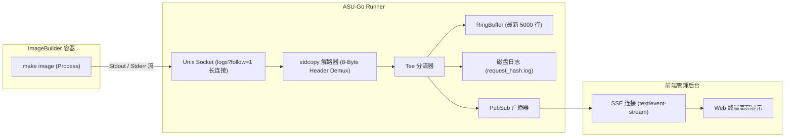

# 容器执行引擎与实时可观测性规范 (Runner & Observability)

本文档深入解析 OpenWrt 固件容器构建执行机制，并解决原版 ASU 中**“构建无 stdout 输出、可观测性严重缺失”**的根本问题。

---

## 1. 为什么原版构建没有 stdout 输出？

### 1.1 原版调用的致命缺陷
原版 ASU（参考 `/data/app-stacks/asu/asu/util.py`）使用 Python `podman` SDK 的 `container.exec_run(...)`：
```python
# 原版调用方式
returncode, output = container.exec_run(command, demux=True, user="buildbot")
stdout: str = output[0].decode("utf-8") if output[0] else ""
```
- **同步缓冲机制**：`container.exec_run` 底层通过阻塞读取流，直到进程完全退出并关闭流后，才把整个缓冲区切片返回。
- 在 `make image` 运行的 2~10 分钟内，标准输出全部积压在容器套接字缓冲区中，宿主机主进程和外部完全无法感知进度。
- 一旦中间卡在依赖包下载或者冲突报错，外部只能干等至整体任务超时。

### 1.2 OpenWrt ImageBuilder 本身静默机制
- ImageBuilder 的 Makefile 默认行为是静默模式，很多子命令被 `@` 抑制或者未输出详细信息。
- 没有 TTY 终端时，部分工具（如 apk / wget / opkg）会关闭进度条，变成全静默下载。

---

## 2. ASU-Go 的流式可观测性技术方案

ASU-Go 采用**容器主进程直接跑构建命令 + `logs?follow=1` 长连接流式读取 + 多路复用解包 + 内存环形缓冲 + SSE 实时广播**的架构。不使用 Hijack，也不做定时轮询。



---

## 3. 核心技术实现细节

### 3.1 容器标准输出的实时读取与解复用
**为什么不需要 Hijack**：Hijack（HTTP `Upgrade` 劫持为双向原始 TCP 连接）只有在 `attach` / `exec start` 这类需要**交互式 stdin** 的场景才必要。我们的构建不需要输入，所以改为：

1. 创建容器时直接把构建命令设为容器的主进程（`Cmd`，不再用 `exec`）。
2. 调用 `GET /containers/{id}/logs?follow=1&stdout=1&stderr=1`。这是一个普通 HTTP 响应，服务端边产生日志边以 chunked 方式推送，客户端读到 EOF 即容器退出。
3. 等价于“推送”而非“轮询”：不需要定时请求，延迟更低，也不会漏行或重复。仅当长连接意外断开时，用 `since=<上次时间戳>` 重连补读，这是兜底而非主路径。
4. 退出码通过 `wait` 接口获取；Kubernetes 的 `pods/log?follow=true` 语义相同，接口因此可以直接复用。

非 TTY 模式下，logs 响应使用 Docker/Podman 统一的 8 字节多路复用帧：
- **Byte 0**: 流类型（`0x01` = Stdout, `0x02` = Stderr）
- **Bytes 1~3**: 保留字节（全 0）
- **Bytes 4~7**: 数据块长度（大端 uint32）

该解帧由驱动内部的 `stdcopy.StdCopy` 完成，对外暴露为已解复用的 `io.ReadCloser`：
```go
// 驱动内部：follow 读取并解复用
rc, err := cli.ContainerLogs(ctx, id, container.LogsOptions{
    ShowStdout: true,
    ShowStderr: true,
    Follow:     true,
})
if err != nil {
    return err
}
defer rc.Close()

// 将 stdout/stderr 实时分流到并发安全的管道
go func() {
    _, _ = stdcopy.StdCopy(stdoutWriter, stderrWriter, rc)
}()
```

### 3.2 构建容器执行流程（取代原版 sleep + exec）
原版：容器主进程为 `sleep`，输入用 `put_archive`，所有步骤走 `exec_run`，产物用 `get_archive`，构建容器没有宿主 bind mount。ASU-Go 保留 put/get_archive 思路，仅把 exec 改为主进程：

1. `prepare` 后通过 `Runtime.InspectImage` 读取镜像 `WorkingDir` 与 `User`；元数据按镜像名缓存在 Runner 进程内，显式 always 拉取（含 rolling 复查）后刷新。工作目录去掉尾随 `/`（根目录保留 `/`），空值回退 `/builder`；OpenWrt 通常是 `/builder`，ImmortalWrt 通常是 `/home/build/immortalwrt`，不按发行版硬编码。`create` 的 WorkingDir、脚本中的 BIN_DIR/FILES、manifest、归档注入和产物回收全部使用这一目录。info 日志记录 `component=runner`、`image`、`working_dir`、`user`。
2. `create`：不覆盖镜像默认运行用户，不设 AutoRemove，不挂载任何宿主路径；沿用原版安全设置（`cap_drop=all`、`no_new_privileges`、非特权）与独立网络 `asu-build`（不存在则自动创建）；打 label `managed-by=asu-go`、`asu.request_hash=<hash>`。`put_archive` 在 `start` 之前注入 defaults 脚本（`asu-files/etc/uci-defaults/99-asu-defaults`）、repositories（apk 为 `repositories`，opkg 为 `repositories.conf`，按镜像内文件检测）、公钥。tar 文件和全部父目录显式设置 uid/gid：数字 `uid:gid` 原样使用，单独 uid 的 gid 取同值，空 User 为 root；用户名或无法推断时回退 `1000:1000` 并记 warn（不在宿主解析镜像用户名）。
3. `start`：主进程为构建脚本，依次执行 `make info`、`make manifest`、`make image`。构建输出目录位于容器自身可写层（原版的 tmpfs 在容器退出后 `get_archive` 读不到）。
4. `logs?follow=1`：Runner 流式读取并解析阶段标记。
5. `wait` 取退出码；`get_archive` 取回产物（容器已退出也可取）；落盘成功后删除容器。

### 3.3 阶段标记（取代 Phase Sniffing）
构建脚本在每个阶段前输出固定标记行：`##asu:stage=<name>`。Runner 解析后得到与原版 `X-Imagebuilder-Status` 一致的阶段值：`init`、`container_setup`、`validate_revision`、`validate_manifest`、`building_image`，并写入任务记录。标记行本身保留在日志中。不再用正则嗅探 ImageBuilder 的输出。

### 3.4 可观测性参数
- `runner.verbose` 默认 true，与任务 `Verbose` 取或后向 `make image` 注入 `V=s`，展示完整打包与安装过程；关闭全局默认不影响诊断请求显式开启。`make info` / `make manifest` 不加 `V=s`。
- 每次阶段切换前输出 `##asu:timing=<上一阶段名> <整数秒>`，退出时也记录最后阶段耗时；只认 `##asu:stage=` 的消费者不会将 timing 或未知 `##asu:` 行误判为阶段，原始行仍保留于构建日志。make 前信息头包括镜像、profile、请求包和播种包数（不等同于最终实际使用包数）。
- 阶段事件（`event: stage`）与 SSE 随管理后台二期实现；一期只提供 follow 式纯文本日志 `GET /admin/api/jobs/{hash}/log?follow=1`。

### 3.5 应用日志（Zap）

应用日志与 `{data_dir}/logs/{id}.log` 的构建输出完全分离：绝不把构建输出行（包括失败时的 tail）复制到 Zap；阶段标记仅提取阶段名称。通过 `log.level` / `log.format` 控制级别与 JSON/console 格式。

- 固定使用 snake_case 字段：`component`（`http` / `queue` / `runner` / `runtime` / `scavenger` 等）、`request_hash`、`job_id`、`distribution`、`version`、`target`、`profile`；HTTP 链路额外带 `request_id`。后台任务不伪造 HTTP request_id，通过 request_hash 关联入队请求。
- 入队、出队（`queue_duration`）、开始/完成/失败（`duration`）、每次阶段变化（`stage`、`previous_stage`、`stage_duration`）均记录。超时/取消通过失败日志中的 `reason` 区分；关闭时记录 kill/remove 清理。耗时字段由 Zap duration encoder 编码，HTTP 的 `latency_ms` 固定毫秒。
- runtime 记录镜像检查/拉取、网络准备、create、put_archive、start、wait（`exit_code`）、get_archive、kill、remove；归档日志只包含 `bytes`，不包含正文。引擎 HTTP API 的方法、路径、状态和耗时使用 debug，不记录查询串、命令或环境变量。不透明句柄仅在 runtime 与 runner 的 Handle 日志中以 `container` 字段出现。
- 重启接管记录任务、句柄与 `replayed_lines`；scavenger 每轮记录 `found` / `removed`；TTL cleaner 记录删除数量、公开 store/诊断产物/日志的 `freed_bytes` 与 `usage_available`。无清理动作使用 debug，有状态变化使用 info，可恢复异常 warn、执行失败 error 并携带 error。
- HTTP 结束摘要包括 method/path/route/status/latency_ms/client_ip/bytes/user_agent/request_id；查询串整体不记录，认证头、Cookie、token 与请求体也不记录。成功健康检查及前端资源降 debug；4xx warn、5xx error（含 panic）。`X-Request-Id` 沿用或生成回写，panic 日志不记录可能含凭据的 panic 内容；SSE/follow 连接在结束时记录。
- 管理登录成功 info、失败 warn，不记录凭据；已认证管理写操作记录操作者、路由、状态与 request_id（token 认证仅以 `api_token` 标记身份）。

### 3.6 跨任务包缓存

`runner.cache.enabled` 默认 true，目录默认为 `{data_dir}/cache`，`max_size_gb` 默认 20（GiB）。覆盖 `dir` 时必须使用专用缓存目录，不要指向产物目录或其他业务数据。每个镜像引用去除 digest 后，将非 `[a-z0-9._-]` 字符替换成 `_`，形成独立目录；不共享镜像 WORKDIR、`packages`、`build_dir` 或 `tmp`。

Create 后、Start 前以 put_archive 向镜像 WorkingDir 注入私有 `dl/` 和包副本，tar 的目录和文件沿用镜像用户 uid/gid。共享仓库只保存普通、非空 `.apk` / `.ipk`，绝不播种或回收 APKINDEX、Packages、签名及其他索引；新容器自行获取新索引。成功取回固件后 get_archive `WorkingDir/dl`，过滤根目录后拒绝嵌套路径、穿越、链接和非包文件，以同目录临时文件加 rename 原子发布；同名已有文件不覆盖。失败构建不回收。

自定义 repositories 请求及 disabled 均跳过播种和回收；播种或回收异常仅 warn，不改变构建结果。共享 Runner Cache 对象通过进程内互斥串行保护播种、回收与淘汰，不支持多个服务进程同时写同一缓存目录。重启接管只有句柄、没有可信原始镜像/仓库信息时保守跳过缓存回收。

Cleaner 在现有周期内扫描包文件总大小，超限按 mtime 从旧到新删除；播种成功 touch 被播种文件，因此是文件级近似 LRU。`max_size_gb: 0` 表示下轮清空包文件，不是无限容量；周期之间可能暂时超过上限。Zap 记录播种/新增包数和字节数、淘汰数，debug 记录 `disabled` / `custom_repos` 跳过原因。缓存只是可重新下载的性能优化，不代替 ImageBuilder 的包完整性和签名校验。

---

### 3.7 构建仓库镜像

`runner.mirrors: []` 默认关闭。每项含 `from` / `to`，仅允许以 `/` 结尾的 HTTP(S) URL 前缀；拒绝空主机、控制字符及空白。示例：

```yaml
runner:
  mirrors:
    - from: https://downloads.immortalwrt.org/
      to: https://mirrors.ustc.edu.cn/immortalwrt/
    - from: https://downloads.openwrt.org/
      to: https://mirrors.ustc.edu.cn/openwrt/
```

顺序固定为：可选 `setup.sh` → 原始仓库镜像替换 → 自定义仓库 replace/append → `make info`。这是保守选择：请求明确提供的自定义地址不应被服务端悄悄替换；append 时原始行使用镜像、自定义行保持原样，replace 时最终全部使用自定义仓库。apk 检测 `repositories`，否则使用 opkg 的 `repositories.conf`。仅匹配行首或空白后的 URL 前缀，不替换其他 URL 中间包含的字符串；规则按配置顺序执行，可能级联，`N` 表示成功执行的规则数，不是命中行数。原始仓库的注释中若出现独立 URL 也可能替换，但不改变包管理行为。

sed 的 BRE 匹配与 replacement 分别转义（含 `#` 分隔符、反斜杠、`&`），整个表达式再用 shell 单引号安全传参（单引号本身拆分转义），不执行配置中的 shell 字符。替换成功后输出 `##asu:mirrors=N`，Runner 写 Zap info「已应用 N 条镜像替换」，保留 `component=runner` / `request_hash` 和 `mirror_count`；空列表不生成替换或日志。接管任务不重放脚本，也不重复记录镜像应用日志。包缓存仅存包文件、不存索引，镜像替换不改变缓存键。

2026-10-28 本机 `curl -L` 实测（保留 shell 的 `https_proxy=http://127.0.0.1:19261`，不是直连结果），以下 USTC OpenWrt 路径均返回 **HTTP 200**：

- `https://mirrors.ustc.edu.cn/openwrt/releases/25.12.6/packages/aarch64_cortex-a53/base/packages.adb`
- `https://mirrors.ustc.edu.cn/openwrt/releases/25.12.6/targets/mediatek/filogic/packages/packages.adb`
- `https://mirrors.ustc.edu.cn/openwrt/releases/25.12.6/targets/mediatek/filogic/kmods/`

前两个响应为 `application/octet-stream`，大小分别为 110760 / 14418 字节；kmods 返回真实目录列表，包含 `6.12.112-1-f0a7348f9cb959e1bf4d0447669b031e/`，不是仅状态码为 200 的错误页。

同日执行 `go test -tags integration ./internal/runner -run '^TestMirrorsPodman$' -v -timeout 15m`：本机 Podman 中 `docker.io/immortalwrt/imagebuilder:mediatek-filogic-openwrt-25.12.2` 与 `ghcr.io/openwrt/imagebuilder:mediatek-filogic-v25.12.6` 均通过。使用生成脚本的实际镜像替换片段，`cat repositories` 确认全部上游仓库改为 USTC，`make info` 与 `make manifest PROFILE=bananapi_bpi-r3 PACKAGES=base-files STRIP_ABI=1` 均成功；分别耗时约 74 / 78 秒。容器使用 host 网络并继承本机代理，未宣称直连性能；该冒烟不执行完整固件构建。

metadata 不受此配置影响：内嵌 sources 默认仍为 `https://downloads.openwrt.org` / `https://downloads.immortalwrt.org`；同步器和 profiles/包索引读取各 source 的 `upstream_url`。若希望元数据也走镜像，使用管理来源编辑（或 `asu source edit`）修改对应 source 的 `upstream_url`（例如 `https://mirrors.ustc.edu.cn/openwrt`），编辑会在 sources 表 `overrides` 中记录 `upstream_url`，后续同步保留该覆盖。只影响被编辑的来源，不自动修改同发行版其他来源；本功能不改 metadata。

## 4. 任务取消与孤儿容器级联清理 (Anti-Zombie)

在原版 Python 实现中，如果服务发生异常崩溃或重启，正在运行的 Podman 构建容器会变成孤儿容器留在系统中，持续占用 CPU 和内存。

ASU-Go 引入三重防护：
1. **Context 级联取消**：
   每个 Runner 任务在启动时在本地嵌入式数据库中记录不透明的 `Handle`。任务被用户取消或超时退出时，`defer` 钩子自动向 Podman 发送 `Kill` 与 `Remove(force=true, volumes=true)`。
2. **重启接管 (Takeover)**：
   服务启动时，对数据库中状态为 `running` 的任务，用 `Handle` 查询容器：
   - 容器仍在运行：重新 `logs?follow=1&timestamps=1` **从头**读取，重建 RingBuffer 并覆写磁盘日志文件（容器日志是权威来源，因此不丢行、不重复），然后继续走正常的 wait / 取产物 / 清理流程。
   - 接管产物路径使用 `Runtime.Inspect` 返回的容器实际 WorkingDir，不重新拉取镜像，也不受同名镜像标签后来变更影响；诊断重放作为新任务重新查询镜像，scavenger 不依赖构建目录。
   - 容器已退出：同样从日志补读，再收尾。
   - 容器不存在：任务标记为 `failed`（`detail: interrupted`）。
   - 前提：容器日志驱动必须可读（json-file / k8s-file / journald），启动时检查，`none` 则拒绝启动。
3. **启动自愈探测器 (Zombie Scavenger)**：
   扫描所有 label 带有 `managed-by=asu-go` 但数据库中没有对应活跃任务的容器，批量异步清理。

---

> **注（运行时抽象）**：上文的 logs 流读取 / 多路复用解包属于 Docker/Podman **驱动内部**实现细节，对外统一暴露为 `Runtime.Logs` 返回的 `io.ReadCloser`（已解复用）。调度与队列层不得依赖这些概念，以便未来接入 Kubernetes 驱动。详见 [tech-stack.md §4](tech-stack.md)。
