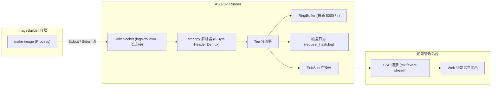

# 容器执行引擎与实时可观测性规范 (Runner & Observability)

本文档深入解析 OpenWrt 固件容器构建执行机制，并解决原版 ASU 中**“构建无 stdout 输出、可观测性严重缺失”**的根本问题。

---

## 1. 为什么原版构建没有 stdout 输出？

### 1.1 原版调用的致命缺陷
原版 ASU（参考 `/data/app-stacks/asu/asu/util.py`）使用 Python `podman` SDK 的 `container.exec_run(...)`：
```python
# 原版调用方式
returncode, output = container.exec_run(command, demux=True, user="buildbot")
stdout: str = output[0].decode("utf-8") if output[0] else ""
```
- **同步缓冲机制**：`container.exec_run` 底层通过阻塞读取流，直到进程完全退出并关闭流后，才把整个缓冲区切片返回。
- 在 `make image` 运行的 2~10 分钟内，标准输出全部积压在容器套接字缓冲区中，宿主机主进程和外部完全无法感知进度。
- 一旦中间卡在依赖包下载或者冲突报错，外部只能干等至整体任务超时。

### 1.2 OpenWrt ImageBuilder 本身静默机制
- ImageBuilder 的 Makefile 默认行为是静默模式，很多子命令被 `@` 抑制或者未输出详细信息。
- 没有 TTY 终端时，部分工具（如 apk / wget / opkg）会关闭进度条，变成全静默下载。

---

## 2. ASU-Go 的流式可观测性技术方案

ASU-Go 采用**容器主进程直接跑构建命令 + `logs?follow=1` 长连接流式读取 + 多路复用解包 + 内存环形缓冲 + SSE 实时广播**的架构。不使用 Hijack，也不做定时轮询。



---

## 3. 核心技术实现细节

### 3.1 容器标准输出的实时读取与解复用
**为什么不需要 Hijack**：Hijack（HTTP `Upgrade` 劫持为双向原始 TCP 连接）只有在 `attach` / `exec start` 这类需要**交互式 stdin** 的场景才必要。我们的构建不需要输入，所以改为：

1. 创建容器时直接把构建命令设为容器的主进程（`Cmd`，不再用 `exec`）。
2. 调用 `GET /containers/{id}/logs?follow=1&stdout=1&stderr=1`。这是一个普通 HTTP 响应，服务端边产生日志边以 chunked 方式推送，客户端读到 EOF 即容器退出。
3. 等价于“推送”而非“轮询”：不需要定时请求，延迟更低，也不会漏行或重复。仅当长连接意外断开时，用 `since=<上次时间戳>` 重连补读，这是兜底而非主路径。
4. 退出码通过 `wait` 接口获取；Kubernetes 的 `pods/log?follow=true` 语义相同，接口因此可以直接复用。

非 TTY 模式下，logs 响应使用 Docker/Podman 统一的 8 字节多路复用帧：
- **Byte 0**: 流类型（`0x01` = Stdout, `0x02` = Stderr）
- **Bytes 1~3**: 保留字节（全 0）
- **Bytes 4~7**: 数据块长度（大端 uint32）

该解帧由驱动内部的 `stdcopy.StdCopy` 完成，对外暴露为已解复用的 `io.ReadCloser`：
```go
// 驱动内部：follow 读取并解复用
rc, err := cli.ContainerLogs(ctx, id, container.LogsOptions{
    ShowStdout: true,
    ShowStderr: true,
    Follow:     true,
})
if err != nil {
    return err
}
defer rc.Close()

// 将 stdout/stderr 实时分流到并发安全的管道
go func() {
    _, _ = stdcopy.StdCopy(stdoutWriter, stderrWriter, rc)
}()
```

### 3.2 构建容器执行流程（取代原版 sleep + exec）
原版：容器主进程为 `sleep`，输入用 `put_archive`，所有步骤走 `exec_run`，产物用 `get_archive`，构建容器没有宿主 bind mount。ASU-Go 保留 put/get_archive 思路，仅把 exec 改为主进程：

1. `create`：不设 AutoRemove，不挂载任何宿主路径；沿用原版安全设置（`cap_drop=all`、`no_new_privileges`、非特权）与独立网络 `asu-build`（不存在则自动创建）；打 label `managed-by=asu-go`、`asu.request_hash=<hash>`。
2. `put_archive`：在 `start` 之前注入 defaults 脚本（`asu-files/etc/uci-defaults/99-asu-defaults`）、repositories（apk 为 `repositories`，opkg 为 `repositories.conf`，按镜像内文件检测）、公钥。
3. `start`：主进程为构建脚本，依次执行 `make info`、`make manifest`、`make image`。构建输出目录位于容器自身可写层（原版的 tmpfs 在容器退出后 `get_archive` 读不到）。
4. `logs?follow=1`：Runner 流式读取并解析阶段标记。
5. `wait` 取退出码；`get_archive` 取回产物（容器已退出也可取）；落盘成功后删除容器。

### 3.3 阶段标记（取代 Phase Sniffing）
构建脚本在每个阶段前输出固定标记行：`##asu:stage=<name>`。Runner 解析后得到与原版 `X-Imagebuilder-Status` 一致的阶段值：`init`、`container_setup`、`validate_revision`、`validate_manifest`、`building_image`，并写入任务记录。标记行本身保留在日志中。不再用正则嗅探 ImageBuilder 的输出。

### 3.4 可观测性参数
- `verbose=true` 时向 `make image` 注入 `V=s`，展示完整打包与安装过程。
- 阶段事件（`event: stage`）与 SSE 随管理后台二期实现；一期只提供 follow 式纯文本日志 `GET /admin/api/jobs/{hash}/log?follow=1`。

---

## 4. 任务取消与孤儿容器级联清理 (Anti-Zombie)

在原版 Python 实现中，如果服务发生异常崩溃或重启，正在运行的 Podman 构建容器会变成孤儿容器留在系统中，持续占用 CPU 和内存。

ASU-Go 引入三重防护：
1. **Context 级联取消**：
   每个 Runner 任务在启动时在本地嵌入式数据库中记录不透明的 `Handle`。任务被用户取消或超时退出时，`defer` 钩子自动向 Podman 发送 `Kill` 与 `Remove(force=true, volumes=true)`。
2. **重启接管 (Takeover)**：
   服务启动时，对数据库中状态为 `running` 的任务，用 `Handle` 查询容器：
   - 容器仍在运行：重新 `logs?follow=1&timestamps=1` **从头**读取，重建 RingBuffer 并覆写磁盘日志文件（容器日志是权威来源，因此不丢行、不重复），然后继续走正常的 wait / 取产物 / 清理流程。
   - 容器已退出：同样从日志补读，再收尾。
   - 容器不存在：任务标记为 `failed`（`detail: interrupted`）。
   - 前提：容器日志驱动必须可读（json-file / k8s-file / journald），启动时检查，`none` 则拒绝启动。
3. **启动自愈探测器 (Zombie Scavenger)**：
   扫描所有 label 带有 `managed-by=asu-go` 但数据库中没有对应活跃任务的容器，批量异步清理。

---

> **注（运行时抽象）**：上文的 logs 流读取 / 多路复用解包属于 Docker/Podman **驱动内部**实现细节，对外统一暴露为 `Runtime.Logs` 返回的 `io.ReadCloser`（已解复用）。调度与队列层不得依赖这些概念，以便未来接入 Kubernetes 驱动。详见 [tech-stack.md §4](tech-stack.md)。
